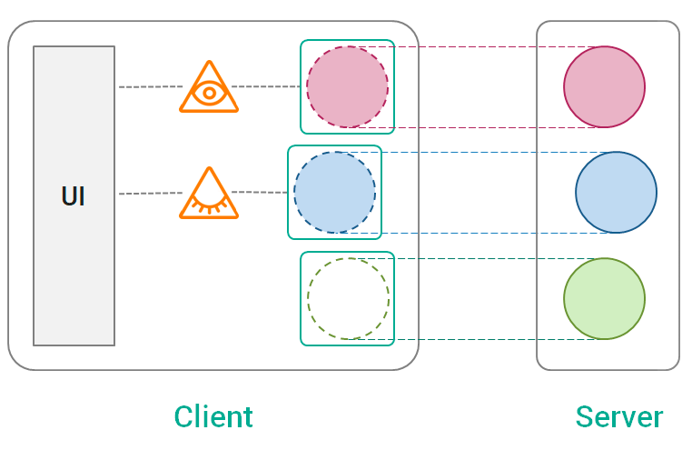
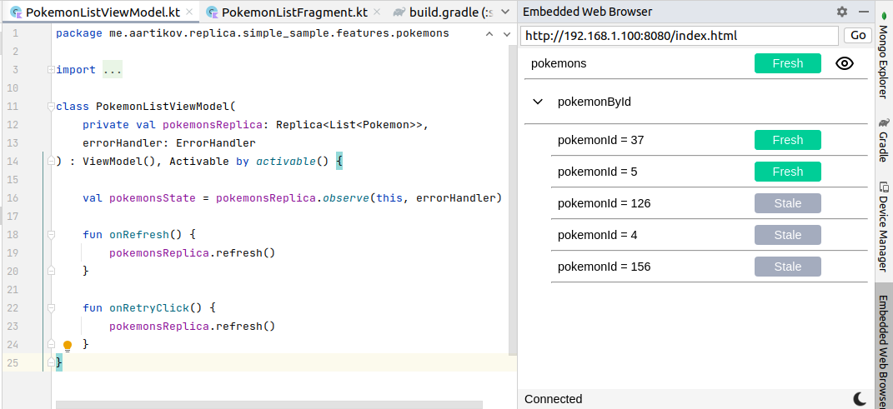
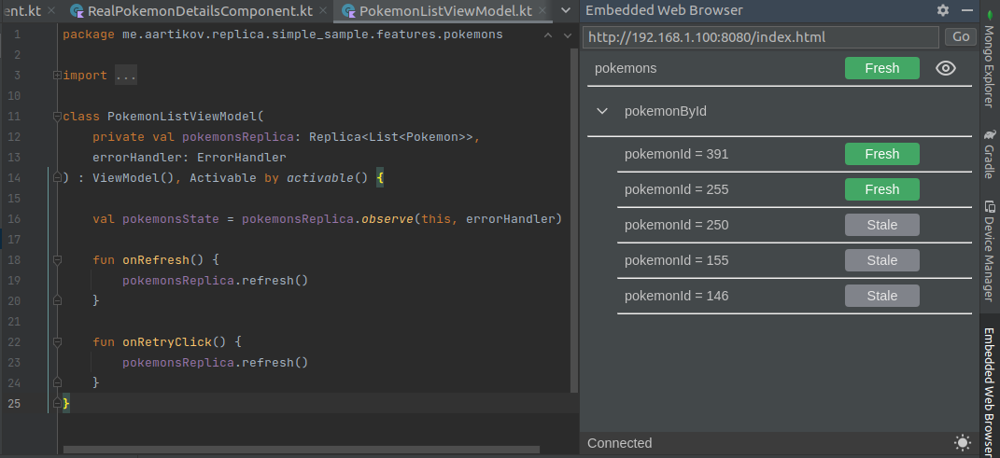

[](https://repo1.maven.org/maven2/com/github/aartikov/replica-core/)
[](https://opensource.org/licenses/MIT)
[](https://aartikov.github.io/Replica/)

<h1 align="center">Replica</h1>

<div align="center">
  Biblioteca KMM para organizar la comunicación de red de manera declarativa.
</div>
<div align="center">
  <strong>Desarrollada en la empresa <a href="https://mobileup.ru/">MobileUp</a>.</strong>
</div>

## Motivación
Mientras que bibliotecas como *Retrofit* y *Kotlin Serialization* ayudan a realizar solicitudes de red, Replica aborda otros desafíos.

Es importante mantener los datos actualizados en el cliente. Pero no debemos realizar solicitudes de red con demasiada frecuencia para no desperdiciar recursos del servidor.

Las aplicaciones modernas de Android necesitan patrones de UX sofisticados como *stale-while-revalidate*, *pull-to-refresh*, *paginación* y *actualizaciones optimistas*. Los desarrolladores tienen que implementar esto una y otra vez sin la herramienta adecuada a mano.

El enfoque imperativo clásico para la red es complejo y propenso a errores. Es difícil lograr el comportamiento deseado orquestando manualmente llamadas individuales a la red.

En resumen, Replica ayuda a:
1. **Mantener los datos del cliente actualizados**
2. **Ahorrar recursos del servidor**
3. **Crear una gran UX**
4. **Escribir código simple y mantenible**

## Características
Replica proporciona:
- Enfoque declarativo para la red
- Independencia de frameworks de red (*Retrofit*, *Ktor*, *Apollo GraphQL* y otros)
- Carga automática de datos basada en pantallas activas
- Caché en memoria y en disco
- Configuración de tiempo de obsolescencia con actualización automática
- Cancelación automática de solicitudes y limpieza de datos antiguos
- Deduplicación de solicitudes
- Soporte para patrones de UX sofisticados
- Reacción ante cambios en el estado de la conexión de red
- Combinación de datos de varias solicitudes
- Integración con [ViewModel](https://developer.android.com/topic/libraries/architecture/viewmodel) y [Decompose](https://github.com/arkivanov/Decompose)
- Herramienta visual de depuración integrada en Android Studio
- Soporte para KMM
- Paginación

## Configuración de Gradle
```gradle
dependencies {

    def replicaVersion = '1.8.0-alpha'

    // Basic usage
    implementation "com.github.aartikov:replica-core:$replicaVersion"

    // Automatic reaction on changes of network connection status
    implementation "com.github.aartikov:replica-android-network:$replicaVersion"

    // Transforming and combining replicas
    implementation "com.github.aartikov:replica-algebra:$replicaVersion"

    // Integration with ViewModel library
    implementation "com.github.aartikov:replica-view-model:$replicaVersion"

    // Integration with Decompose library
    implementation "com.github.aartikov:replica-decompose:$replicaVersion"

    // Debug tool
    debugImplementation "com.github.aartikov:replica-devtools:$replicaVersion"
    releaseImplementation "com.github.aartikov:replica-devtools-noop:$replicaVersion"
}
```

## Cómo funciona
La biblioteca se basa en un concepto llamado **replicación de datos**. La idea es sencilla. Hay algunos datos en un servidor. Un cliente necesita estos datos. Replica representa automáticamente los datos del servidor en el lado del cliente y los mantiene sincronizados.

Replica proporciona primitivas de replicación de datos llamadas **réplicas**. Cada réplica apunta a un fragmento de datos en un servidor y lo replica en un cliente.

Y el último concepto es el de **observadores de réplica**. Los observadores de réplica son necesarios para mostrar los datos en la IU. Un observador se conecta a una réplica y transfiere su estado a la IU. Una réplica sabe cuántos observadores tiene y realiza un comportamiento complejo basándose en esta información.



## Uso básico
El código típico con Replica se ve así:

1. **Crear una réplica en el Repositorio**

```kotlin
class PokemonRepository(
    replicaClient: ReplicaClient,
    api: PokemonApi
) {

    val pokemonsReplica: Replica<List<Pokemon>> = replicaClient.createReplica(
        name = "pokemons",
        settings = ReplicaSettings(staleTime = 1.minutes),
        fetcher = {
            api.getPokemons().toDomain()
        }
    )
}
```

2. **Observar una réplica en ViewModel**
```kotlin
class PokemonListViewModel(
    private val pokemonsReplica: Replica<List<Pokemon>>,
    errorHandler: ErrorHandler
) : ViewModel(), Activable by activable() {

    val pokemonsState = pokemonsReplica.observe(this, errorHandler)

}
```

3. **Mostrar el estado en la IU**
```kotlin
viewLifecycleOwner.lifecycleScope.launch {
    repeatOnLifecycle(Lifecycle.State.STARTED) {
        viewModel.pokemonsState.collect { state ->
            val (loading, data, error) = state
            when {
                data != null -> {
                    // show a list of pokemons
                }
                loading -> {
                    // show a fullscreen progress
                }
                error != null -> {
                    // show a fullscreen error
                }
            }
        }
    }
}
```

## Replica DevTools

Replica cuenta con una herramienta de depuración integrada en Android Studio. Permite supervisar las réplicas, sus estados y observadores.



Por supuesto, se admite el tema oscuro.




## Más información
### Ejemplos
- [Ejemplo simple](https://github.com/aartikov/Replica/tree/main/simple-sample) - muestra el uso básico de Replica. 
- [Ejemplo avanzado](https://github.com/aartikov/Replica/tree/main/advanced-sample) - muestra técnicas avanzadas: observar datos mediante clave dinámica, actualizaciones optimistas, integración con [Decompose](https://github.com/arkivanov/Decompose). La arquitectura de este ejemplo se basa en [MobileUp Android Template](https://github.com/MobileUpLLC/MobileUp-Android-Template).

### Documentación
[Documentación de Replica](https://aartikov.github.io/Replica/) - un sitio web con documentación detallada (en desarrollo).

## Contacto con el autor
Artur Artikov

telegram - <a href="https://t.me/aartikov">@aartikov</a>, correo electrónico - <a href="mailto:a.artikov@gmail.com">a.artikov@gmail.com</a>

## Agradecimientos especiales
A <a href="https://github.com/EgoriusE">Egor Belov</a> por la ayuda con Replica DevTools y las pruebas unitarias.

## Licencia
```
The MIT License (MIT)

Copyright (c) 2023 Artur Artikov, Egor Belov
Permission is hereby granted, free of charge, to any person obtaining a copy
of this software and associated documentation files (the "Software"), to deal
in the Software without restriction, including without limitation the rights
to use, copy, modify, merge, publish, distribute, sublicense, and/or sell
copies of the Software, and to permit persons to whom the Software is
furnished to do so, subject to the following conditions:

The above copyright notice and this permission notice shall be included in all
copies or substantial portions of the Software.

THE SOFTWARE IS PROVIDED "AS IS", WITHOUT WARRANTY OF ANY KIND, EXPRESS OR
IMPLIED, INCLUDING BUT NOT LIMITED TO THE WARRANTIES OF MERCHANTABILITY,
FITNESS FOR A PARTICULAR PURPOSE AND NONINFRINGEMENT. IN NO EVENT SHALL THE
AUTHORS OR COPYRIGHT HOLDERS BE LIABLE FOR ANY CLAIM, DAMAGES OR OTHER
LIABILITY, WHETHER IN AN ACTION OF CONTRACT, TORT OR OTHERWISE, ARISING FROM,
OUT OF OR IN CONNECTION WITH THE SOFTWARE OR THE USE OR OTHER DEALINGS IN THE
SOFTWARE.
```
